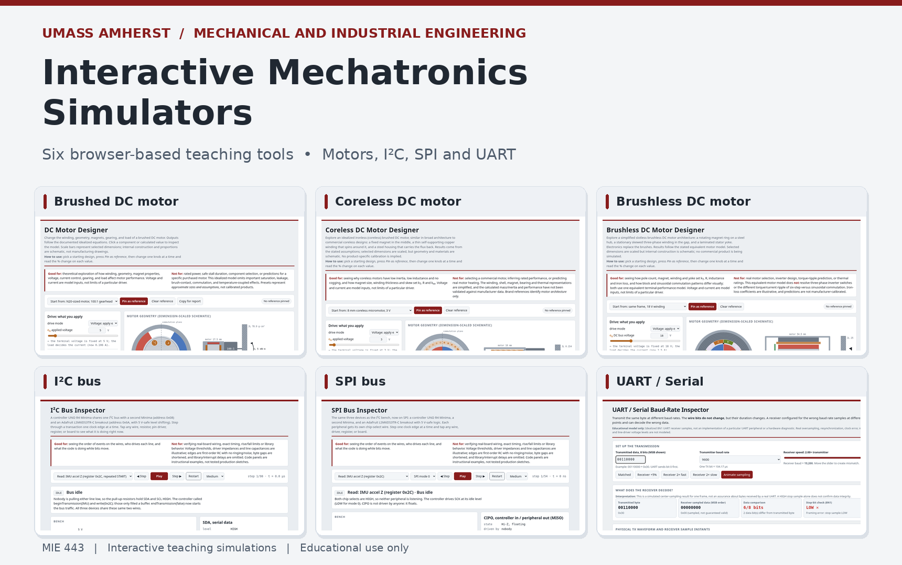
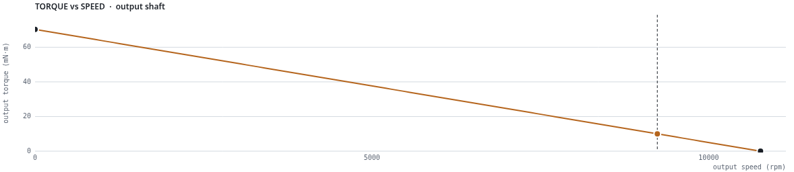

# MIE 443 | Interactive Mechatronics Simulators

**University of Massachusetts Amherst**  
Department of Mechanical and Industrial Engineering  
Frank C. Sup IV

Six interactive, standalone browser-based teaching simulations covering **electric motor design**, **motor dynamics**, and **digital communication protocols**. They help students investigate relationships, interpret equations, and formulate questions for laboratory testing. The motor designers are **first-principles conceptual models**, not reconstructions of specific commercial motors; the bus inspectors are **transaction/timing illustrations**, not hardware emulators.



> [!IMPORTANT]
> **Educational use only.** These simulators are idealized instructional models, not validated engineering design software, hardware test instruments, or safety-analysis tools. Do not use their outputs to select or rate components, establish operating limits, design safety-critical systems, or verify electrical connections without independent analysis, current manufacturer documentation, and appropriate testing. See [Model limitations and disclaimer](#model-limitations-and-disclaimer) and [Detailed model and validation notes](MODEL_NOTES.md).

## Launch the simulators

**[Open the interactive simulator collection](https://umass-mrrl.github.io/Mechatronics/)**

Choose a simulator below to **run it in your browser**. Each image and **Run Online** link opens the interactive GitHub Pages version; **View Source** opens the corresponding HTML in this GitHub repository. No MATLAB, Python, or software installation is required. If a page is not yet available, check that its HTML file has been committed to `main` and that GitHub Pages has finished deploying.

### Electric motor design and dynamics

| Brushed DC Motor | Coreless DC Motor | Brushless DC Motor |
|:--:|:--:|:--:|
| [](https://umass-mrrl.github.io/Mechatronics/motor.html) | [](https://umass-mrrl.github.io/Mechatronics/coreless.html) | [](https://umass-mrrl.github.io/Mechatronics/brushless.html) |
| **[▶ Run Online](https://umass-mrrl.github.io/Mechatronics/motor.html)** · [View Source](https://github.com/UMass-MRRL/Mechatronics/blob/main/motor.html) | **[▶ Run Online](https://umass-mrrl.github.io/Mechatronics/coreless.html)** · [View Source](https://github.com/UMass-MRRL/Mechatronics/blob/main/coreless.html) | **[▶ Run Online](https://umass-mrrl.github.io/Mechatronics/brushless.html)** · [View Source](https://github.com/UMass-MRRL/Mechatronics/blob/main/brushless.html) |
| Winding turns, wire diameter, geometry, magnet selection, load, gearing, a prominent classic torque-versus-speed graph (speed on X, torque on Y), transient response, and sensitivity. | Ironless winding geometry, rotating copper shell, magnet dimensions, torque and inertia, conventional torque-speed characteristic, dynamic response, and thermal trends. | Slotless brushless topology, pole count, stationary phase winding, yoke flux, theoretical iron loss, conventional torque-speed characteristic, and commutation visualization. |

### Classic torque-speed characteristic

All three motor pages display the familiar motor characteristic as a **primary full-width graph**, with **output speed (rpm) on the horizontal axis** and **available output torque (mN·m) on the vertical axis**. The plots indicate the model-predicted **stall torque**, **no-load speed**, and **selected operating point**; a pinned design appears as a dashed comparison. Voltage-driven examples typically produce a straight line in these idealized models. Ideal current regulation can introduce a piecewise curve. None of these lines establishes continuous-duty ratings.



### Optional MATLAB version (brushed DC motor)

Prefer working in MATLAB? **[Download DC Motor Designer for MATLAB v2.3 (ZIP)](https://umass-mrrl.github.io/Mechatronics/DCMotorDesignerMATLAB_v2.3.zip)**. This is an additional interactive brushed DC motor teaching tool with motor drawings, performance curves, transient and thermal responses, and sensitivity analysis. The prior v2.2 GUI was run successfully by the author; the v2.3 plotting update still requires a MATLAB runtime check. It is a **separate implementation**, not an exact numerical replica of the browser simulator.

The GUI requires **base MATLAB**; no additional App Designer toolbox is needed. The ZIP also contains an **optional Simulink model generator**, which requires Simulink. The browser simulators remain fully usable without MATLAB.

### Digital communication and timing

| I²C Bus Inspector | SPI Bus Inspector | UART / Serial Inspector |
|:--:|:--:|:--:|
| [](https://umass-mrrl.github.io/Mechatronics/i2c.html) | [](https://umass-mrrl.github.io/Mechatronics/spi.html) | [](https://umass-mrrl.github.io/Mechatronics/uart.html) |
| **[▶ Run Online](https://umass-mrrl.github.io/Mechatronics/i2c.html)** · [View Source](https://github.com/UMass-MRRL/Mechatronics/blob/main/i2c.html) | **[▶ Run Online](https://umass-mrrl.github.io/Mechatronics/spi.html)** · [View Source](https://github.com/UMass-MRRL/Mechatronics/blob/main/spi.html) | **[▶ Run Online](https://umass-mrrl.github.io/Mechatronics/uart.html)** · [View Source](https://github.com/UMass-MRRL/Mechatronics/blob/main/uart.html) |
| Open-drain SDA/SCL, pull-up resistance, clock edges, address selection, ACK/NACK, and register transactions. | SCK, COPI/CIPO (MOSI/MISO), active-low chip select, full-duplex shifting, timing modes, and selected-peripheral behavior. | 8N1 framing, least-significant-bit-first transmission, adjustable transmitter/receiver baud rates, sampling, decoding, and framing errors. |

## Getting started

### Option A: Run online (recommended for students)

Open **[the simulator collection](https://umass-mrrl.github.io/Mechatronics/)** or select **Run Online** above. All simulation controls work directly in the browser once the corresponding HTML file is deployed. GitHub's **View Source** pages show code and do not run the simulators.

### Option B: Open locally

1. Download the repository as a ZIP or clone it.
2. Open **`index.html`** in a modern desktop browser, or open any simulator HTML file individually.
3. Use the controls, inspect components and calculated values, and step through the scenarios.

**No installation, build process, MATLAB/Python runtime, or JavaScript framework is required.** The simulation logic runs in the browser. Some pages request optional web fonts; the functional simulations do not depend on those fonts.

### Option C: Try the MATLAB DC Motor Designer (optional)

1. Download **[DCMotorDesignerMATLAB_v2.3.zip](https://umass-mrrl.github.io/Mechatronics/DCMotorDesignerMATLAB_v2.3.zip)** and extract it.
2. In MATLAB, set the **Current Folder** to the extracted directory.
3. Run:

   ```matlab
   DCMotorDesignerMATLAB
   ```

The MATLAB GUI is self-contained in `DCMotorDesignerMATLAB.m`. See the README included in the ZIP for the optional Simulink exercise, numerical test script, and modeling assumptions.

### For repository maintainers: GitHub Pages

The live links assume this repository is published from the `main` branch, repository root, at `https://umass-mrrl.github.io/Mechatronics/`. To configure or check deployment, open **Settings → Pages**, then verify **Deploy from a branch → main → / (root)**. Keep `index.html`, the six simulator HTML files, `README.md`, and the `assets/` folder at repository root. New uploads may take time to appear on GitHub Pages after a commit.

### Recommended repository layout

```text
.
├── README.md
├── index.html
├── motor.html
├── coreless.html
├── brushless.html
├── i2c.html
├── spi.html
├── uart.html
├── DCMotorDesignerMATLAB_v2.3.zip  # Optional MATLAB demo
├── MODEL_NOTES.md
├── RELEASE_NOTES.md
└── assets/
    ├── overview.png
    ├── torque_speed.png
    ├── motor.png
    ├── coreless.png
    ├── brushless.png
    ├── i2c.png
    ├── spi.png
    └── uart.png
```

The `assets/` directory contains documentation screenshots, not simulator dependencies. Keep the relative paths intact so the images render in the README.

## Learning objectives

The motor simulators are designed to help students connect electromagnetic and mechanical design choices to behavior:

- Relate winding, magnetic flux, and geometry to motor constants, resistance, speed, torque, and power.
- Separate steady-state operating points from transient response and approximate thermal behavior.
- Compare conventional brushed, ironless coreless, and brushless motor constructions while identifying the assumptions behind the comparison.
- Explore parameter sensitivities and understand why a theoretical maximum is not necessarily a continuous operating rating.

The bus simulators focus on what is happening at the signal and protocol levels:

- Track the sequence of a transaction and which device is driving each line.
- Contrast I²C open-drain signaling with SPI's driven signals and explicit peripheral selection.
- Understand how baud-rate mismatch shifts UART sampling instants without changing the transmitted data bits.
- Connect the waveform to register transactions, received bytes, and possible communication errors.

## Example hardware in the protocol diagrams

The I²C and SPI examples use a **generic teaching bench** with two Arduino UNO R4 Minima boards and an **Adafruit LSM6DS3TR-C breakout**. The breakout's onboard level shifting supports 5 V controller logic; **the bare LSM6DS3TR-C IC is not itself a 5 V logic device**. See the [Adafruit breakout guide](https://learn.adafruit.com/adafruit-lsm6ds3tr-c-6-dof-accel-gyro-imu/pinouts) and the relevant device datasheets before constructing actual circuitry.

The UART example models an idealized asynchronous serial link, not a complete physical-layer noise or clock-recovery system.

## Interpretation guide

| What you see | Appropriate interpretation | Do **not** infer |
|---|---|---|
| Motor speed/torque/power and efficiency | Values of a simplified mathematical model under the chosen parameters | Manufacturer specifications, validated efficiency maps, or continuous ratings |
| Motor temperatures or stall threshold | Outcomes of an approximate two-node thermal calculation | Safe stall time, winding insulation rating, or cooling design approval |
| Dimensioned motor drawings | Schematic drawings with selected dimensions scaled | Manufacturing geometry, tolerances, leakage flux, or complete magnetic construction |
| Coreless/brushless preset names | Illustrative sizes/architectures | Official maxon/FAULHABER simulations or numerical agreement with any product |
| Brushless commutation selector | Visualization of different current/field presentations | Separately solved PWM inverter, three-phase torque ripple, or switching losses |
| I²C/SPI voltage traces | First-order electrical teaching approximation | Passing an actual electrical specification, signal integrity, or 5 V compatibility of arbitrary parts |
| UART receiver result | An ideal fixed-center sampling exercise | Behavior of a particular UART peripheral or a reliable transmission error detector |

**Verification is not validation.** The web pages have been exercised in a browser, and selected equations and transactions were checked, but no systematic benchmark against measured motors or physical bus captures is provided. See [MODEL_NOTES.md](MODEL_NOTES.md) for equations, omissions, illustrative parameters, and a release checklist.

## Model limitations and disclaimer

**FOR EDUCATIONAL AND DEMONSTRATION PURPOSES ONLY.**

These simulations intentionally simplify real electromechanical and digital systems. In particular:

- **Motors:** Geometries, magnetic circuits, winding fill, friction, iron losses, commutation, gearbox behavior, thermal networks, and material properties are simplified. Calculated power, temperature, speed, torque, and any stall-time estimate are theoretical outputs, not rated or validated hardware specifications. Open-loop voltage/current drive and regenerative operation assume idealized electrical behavior. The brushless six-step versus sinusoidal selection affects the illustration, not a separately solved inverter/phase-current model. High-flux or saturated states can fall outside model validity.
- **I²C and SPI:** Signal integrity, rise times, output impedance, clocking, board interconnects, and transaction timing use instructional approximations. Register data values are examples; presented code is conceptual and has not been verified as a standalone hardware sketch. The illustrated bus connections are not substitutes for a wiring diagram, checked pin assignments, or a verified voltage-compatibility analysis. The breakout-level-shifter statement applies to the **Adafruit breakout**, not the bare LSM6DS3TR-C chip.
- **UART:** Receiver sampling illustrates baud mismatch under ideal assumptions (8N1, single start edge, center sampling). Real UARTs commonly employ implementation-dependent oversampling, synchronization and error handling. This page is not a serial transceiver model; a passing stop-bit check does not guarantee correct data.
- **MATLAB option:** The included v2.3 ZIP is a separate, simplified educational implementation of the brushed DC motor model. It is not an independently validated motor-design tool, and it is not guaranteed to reproduce every numerical result of the browser version.

**No quantitative motor-accuracy claim, hardware-compliance claim, or fitness-for-purpose claim is made.** Before applying any result to real hardware, verify it against primary datasheets, engineering calculations, relevant standards, and physical measurements. The author and university are not providing certification, design approval, or an assurance of safe operation.

## Recommended classroom use

1. **Predict first.** Ask students to record a qualitative or quantitative prediction before moving a slider.
2. **Inspect assumptions.** Have students locate a neglected effect (for example, motor saturation, winding temperature feedback, or UART oversampling) and state how it might change the result.
3. **Calculate independently.** Reproduce at least one equation or timing relationship without relying on the displayed result.
4. **Measure where feasible.** Compare modeled DC motor startup or bus traces with Arduino/oscilloscope observations; report discrepancies rather than forcing agreement.

## Primary references and further reading

- [Adafruit LSM6DS3TR-C breakout pinouts](https://learn.adafruit.com/adafruit-lsm6ds3tr-c-6-dof-accel-gyro-imu/pinouts), including I²C address options, 10 kΩ board pull-ups, and 3–5 V logic-level compatibility of the **breakout**.
- [ST LSM6DS3TR-C datasheet](https://cdn-shop.adafruit.com/product-files/4503/4503_LSM6DS3TR-C_datasheet.pdf), for the bare device register map and electrical limits.
- [NXP UM10204 I²C-bus specification](https://www.nxp.com/docs/en/user-guide/UM10204.pdf), for protocol definitions and standardized timing/electrical requirements.
- [MODEL_NOTES.md](MODEL_NOTES.md), for this software's equations, simplifications, and current validation status.

These are references, not an assertion that every scenario has been checked for compliance with their specifications.

## Authorship, AI assistance, and citation

**Author and course context:** Frank C. Sup IV, Professor, Department of Mechanical and Industrial Engineering, University of Massachusetts Amherst. Developed for MIE 443 Mechatronics.

**AI use disclosure:** Simulation code and explanatory text were developed with assistance from Claude (Anthropic) and subsequently revised with assistance from ChatGPT (OpenAI), under the author's direction. The author is responsible for reviewing, adapting, and maintaining the educational content.

Suggested citation:

> Sup, F. C., IV. (2026). *MIE 443 interactive simulators* [Interactive teaching software]. University of Massachusetts Amherst. https://github.com/UMass-MRRL/Mechatronics

**Licensing:** No software license is included with these files. Consider adding a `LICENSE` file if reuse and redistribution should be permitted; a public repository does not itself grant an open-source license. Brand and product names in the illustrations identify example architectures/components and imply **no manufacturer affiliation, endorsement, or performance equivalence**.

---

*October 2026. Screenshots show simulator-generated interface views, not measurements. Model/documentation labels may differ slightly from an earlier screenshot.*
