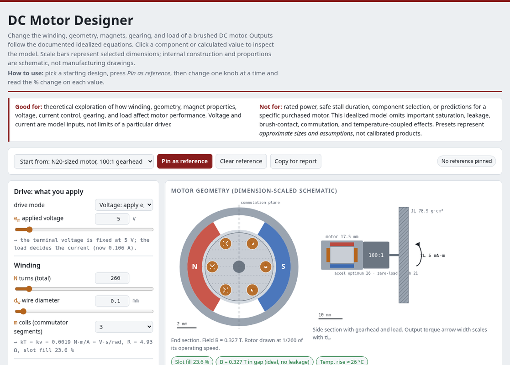
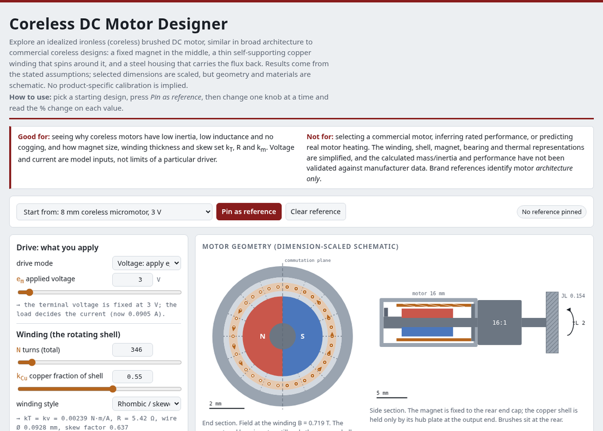
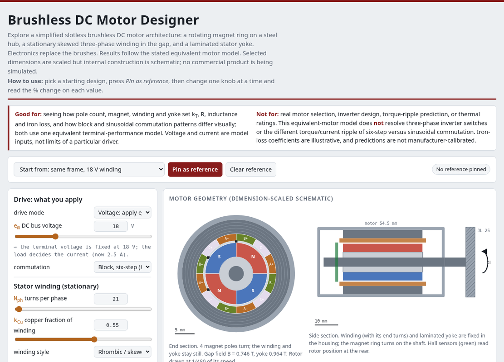
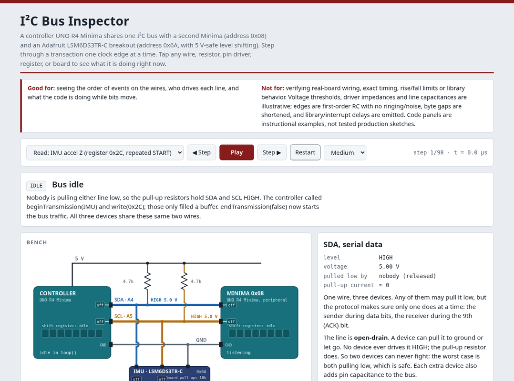
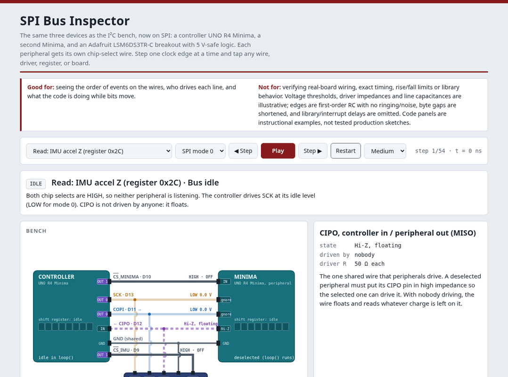
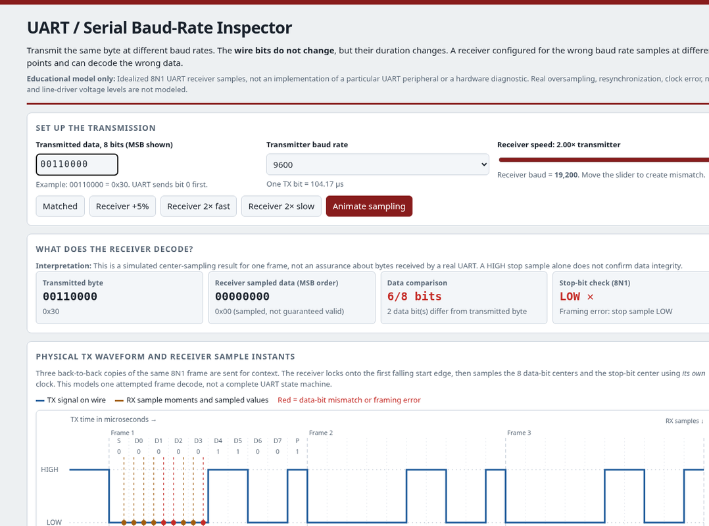

# MIE 443 | Interactive Mechatronics Simulators

**Frank C. Sup IV · Mechanical & Industrial Engineering · University of Massachusetts Amherst**

Six interactive simulations for exploring motor behavior and digital communication. Each HTML simulator runs independently in a browser.

**[Launch the simulator collection](https://umass-mrrl.github.io/Mechatronics/)**

> **Educational use only.** These are simplified teaching models, not validated motor-design software, electrical schematics, or component ratings. Verify any real-world design with datasheets, calculations, and measurements. See [Model notes](MODEL_NOTES.md).

## Motor simulators

| Brushed DC | Coreless DC | Brushless DC |
|:--:|:--:|:--:|
| [](https://umass-mrrl.github.io/Mechatronics/motor.html?v=flywheel-20261022) | [](https://umass-mrrl.github.io/Mechatronics/coreless.html?v=flywheel-20261022) | [](https://umass-mrrl.github.io/Mechatronics/brushless.html?v=flywheel-20261022) |
| **[Run online](https://umass-mrrl.github.io/Mechatronics/motor.html?v=flywheel-20261022)** · [Source](motor.html) | **[Run online](https://umass-mrrl.github.io/Mechatronics/coreless.html?v=flywheel-20261022)** · [Source](coreless.html) | **[Run online](https://umass-mrrl.github.io/Mechatronics/brushless.html?v=flywheel-20261022)** · [Source](brushless.html) |
| Explore windings, magnets, gearing, load, and thermal response. | Explore ironless winding geometry, inertia, and performance. | Explore pole count, winding, losses, and commutation illustrations. |

All three show **torque, current, power, and efficiency versus speed**, along with transient response. Their torque-speed plots compare the current design with a starting baseline and show the requested load. Results are predictions of the stated models, not continuous operating ratings.

## Communication simulators

| I²C | SPI | UART / Serial |
|:--:|:--:|:--:|
| [](https://umass-mrrl.github.io/Mechatronics/i2c.html) | [](https://umass-mrrl.github.io/Mechatronics/spi.html) | [](https://umass-mrrl.github.io/Mechatronics/uart.html) |
| **[Run online](https://umass-mrrl.github.io/Mechatronics/i2c.html)** · [Source](i2c.html) | **[Run online](https://umass-mrrl.github.io/Mechatronics/spi.html)** · [Source](spi.html) | **[Run online](https://umass-mrrl.github.io/Mechatronics/uart.html)** · [Source](uart.html) |
| Addresses, ACK/NACK, pull-ups, and register transfers. | Chip select, clock modes, and full-duplex transfers. | Baud-rate mismatch, bit sampling, and framing errors. |

I²C and SPI use an example **Adafruit LSM6DS3TR-C breakout**, which supports 5 V controller logic through onboard level shifting. The *bare sensor IC* is not 5 V tolerant.

## Optional MATLAB motor designer

**[Download MATLAB DC Motor Designer v2.6.1 (ZIP)](DCMotorDesignerMATLAB_v2.6.1.zip)**

Extract the ZIP, set MATLAB's current folder to the extracted files, and run:

```matlab
DCMotorDesignerMATLAB
```

The graphical demo uses **base MATLAB**; its optional block-diagram generator requires **Simulink**. This is a separate brushed DC model, not an exact replica of the browser version. The author has run v2.2; the later v2.6 UI revisions have not been independently runtime-tested.

## Running locally

Download or clone the repository, then open `index.html` or any simulator `.html` file in a desktop browser. No build step or MATLAB installation is needed for the web simulators.

## About the models

The motor examples use idealized electromagnetic, mechanical, gearbox, and thermal models. The flywheel is modeled as a solid steel disk (7,850 kg/m³), mounted at the gearbox output. Bus waveforms and example data are illustrative, not hardware verification. **[Model notes](MODEL_NOTES.md)** gives the main equations, assumptions, and validation status.

Created for **MIE 443 Mechatronics** by Frank C. Sup IV. Developed with assistance from Claude (Anthropic) and ChatGPT (OpenAI); the author is responsible for review and maintenance.

Suggested citation: Sup, F. C., IV. (2026). *MIE 443 Interactive Mechatronics Simulators*. University of Massachusetts Amherst. https://github.com/UMass-MRRL/Mechatronics

No reuse license is included in this repository.
